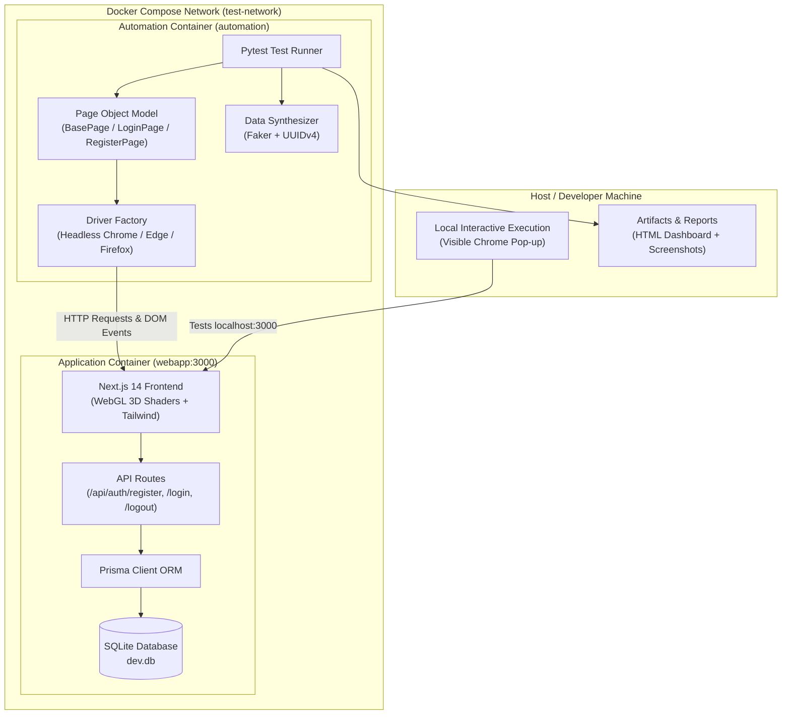

# 🚀 Enterprise Web Automation & Quality Engineering Framework

<div align="center">


<br/>

**A Production-Ready, End-to-End Test Automation Ecosystem Engineered for Complex Web Applications.**

*Featuring a custom high-performance Next.js System Under Test (SUT) with WebGL 3D shaders, containerized orchestration via Docker Compose, Page Object Model (POM) architecture, dynamic persona synthesis with Faker/UUID, automated screenshot captures on both success and error states, and continuous Allure report deployment.*

---

</div>

## 📑 Table of Contents
1. [Executive Summary](#-executive-summary)
2. [High-Level Architecture](#-high-level-architecture)
3. [The System Under Test (SUT)](#-the-system-under-test-sut)
4. [Selenium Automation Framework Architecture](#-selenium-automation-framework-architecture)
5. [Test Scenarios & Quality Matrix](#-test-scenarios--quality-matrix)
6. [Visual Evidence & Screenshot Diagnostics](#-visual-evidence--screenshot-diagnostics)
7. [Getting Started & Execution Modes](#-getting-started--execution-modes)
   - [Mode A: Local Visual Execution (Physical Browser)](#mode-a-local-visual-execution-watch-chrome-live)
   - [Mode B: Docker Containerized Orchestration](#mode-b-docker-containerized-orchestration)
   - [Mode C: Cloud CI/CD Automation](#mode-c-cloud-cicd-automation-github-actions)
8. [Directory Structure](#-directory-structure)
9. [Interview & Viva Defense Guide](#-interview--viva-defense-guide)

---

## 🎯 Executive Summary

In enterprise environments, automation suites cannot rely on fragile, mock HTML pages or public endpoints that trigger rate-limits. This project solves that by delivering a **complete two-tier quality engineering platform**:

1. **The Application Tier (Target Application):** A full-stack, enterprise-grade authentication application built with **Next.js 14 App Router**, **Prisma ORM**, **SQLite**, and GPU-accelerated **WebGL animations (OGL shaders)**.
2. **The Automation Tier (Testing Engine):** A scalable **Python 3.11 + Selenium WebDriver** test framework adhering strictly to the **Page Object Model (POM)** pattern, backed by `pytest`, dynamic data generation, explicit smart synchronization, and automated artifact capturing.

---

## 🏛️ High-Level Architecture



---

## 💻 The System Under Test (SUT)

The target web application is built to simulate a high-security enterprise platform:

* **Landing Page (`/`):** Interactive **WebThreads** WebGL shader background featuring dynamic fluid physics and particle refraction.
* **Authentication Portal (`/login`):** Ambient **Topography** elevation contour lines rendered via custom fragment shaders, complete with real-time field validation and secure JWT session creation. Includes a fixed glassmorphic **"← Back to Home"** button.
* **Onboarding Portal (`/register`):** High-speed **LightTunnel** raymarching animation, password complexity enforcement, duplicate record prevention, and direct password hashing via `bcryptjs`. Includes a fixed glassmorphic **"← Back to Home"** button.
* **Protected Dashboard (`/dashboard`):** Secure enterprise workspace guarded by server-side cookie verification. Displays live session metadata, account metrics, and a secure session-clearing sign-out trigger.

---

## 🤖 Selenium Automation Framework Architecture

The test suite is structured around industry-standard software design patterns:

### 1. Page Object Model (POM)
Element locators are completely decoupled from test assertions. If the front-end redesigns an input field, only the corresponding Page Object requires updates:
* **`automation/pages/base_page.py`:** Base class implementing smart synchronization (`WebDriverWait`), click interceptors, input handling, and stale-element recovery.
* **`automation/pages/login_page.py`:** Encapsulates email/password fields, submission buttons, error banners, and dashboard navigation guards using resilient `data-testid` selectors.
* **`automation/pages/register_page.py`:** Encapsulates registration fields, submission controls, and post-registration redirect monitors.

### 2. Zero-Mock Dynamic Persona Synthesis
Tests never use hardcoded strings like `test@example.com` which cause collisions. Every test dynamically synthesizes fresh credentials:
* **Unique ID Generation:** Uses Python `uuid.uuid4()[:8]` to generate isolated,衝突-proof identifiers per execution.
* **Realistic Faker Datasets:** Utilizes `faker.Faker()` in `automation/utils/data_generator.py` to synthesize realistic user profiles on the fly.

### 3. Smart Synchronization (Anti-Flake Design)
* Never utilizes rigid `time.sleep()` blockers.
* Uses **Explicit Waits** (`WebDriverWait`) targeting expected DOM conditions (`element_to_be_clickable`, `visibility_of_element_located`, `url_contains`).
* Configured with `--disable-dev-shm-usage` and `--no-sandbox` flags in `driver_factory.py` to prevent Linux Docker out-of-memory crashes during heavy WebGL rendering.

---

## 🧪 Test Scenarios & Quality Matrix

| Test ID | Test Category | Scenario Description | Expected Outcome | Visual Evidence Captured |
|:---|:---|:---|:---|:---:|
| **`E2E-01`** | **End-to-End Lifecycle** | Full journey: Register fresh user -> Redirect to Login -> Submit Credentials -> Enter Dashboard -> Verify Session -> Logout | ✅ Dashboard active -> Login page returned | 📸 `E2E_Dashboard_View` |
| **`LOGIN-01`** | **Positive Regression** | Valid user authentication using dynamic database persona | ✅ Redirect to `/dashboard` | 📸 `LOGIN_REAL_01_SUCCESS` |
| **`LOGIN-02`** | **Negative Testing** | Valid email with generated randomized incorrect password | ❌ Red alert: *"Invalid email or password"* | 📸 `LOGIN_REAL_02_ERROR_SHOWN` |
| **`LOGIN-03`** | **Negative Testing** | Non-existent randomized email address | ❌ Red alert: *"Invalid email or password"* | 📸 `LOGIN_REAL_03_ERROR_SHOWN` |
| **`LOGIN-04`** | **Negative Testing** | Empty password submission | ❌ Error alert: *"Password is required"* | 📸 `LOGIN_REAL_04_ERROR_SHOWN` |
| **`REG-01`** | **Positive Registration**| Clean persona registration with valid length constraints | ✅ Redirect to `/login` | 📸 `REG_SUCCESS` |
| **`REG-02`** | **Negative Registration**| Submission with username `< 3` characters | ❌ Error: *"Username must be at least 3 characters"* | 📸 `REG_ERROR_SHOWN` |
| **`REG-03`** | **Negative Registration**| Submission with invalid email format (missing `@`) | ❌ Error: *"Invalid email format"* | 📸 `REG_ERROR_SHOWN` |
| **`REG-04`** | **Negative Registration**| Submission with short password (`< 6` chars) | ❌ Error: *"Password must be at least 6 characters"* | 📸 `REG_ERROR_SHOWN` |

---

## 📸 Visual Evidence & Screenshot Diagnostics

Every run automatically captures photographic proof of execution inside the `screenshots/` directory:

1. **Success States:** Captures the full dashboard page showing authenticated user profile details and status cards.
2. **Failure & Error States:** Captures the exact moment an error banner displays, preserving photographic evidence of negative validations.
3. **Unexpected Failures:** Pytest hook (`pytest_runtest_makereport` in `conftest.py`) captures a timestamped screenshot on any unhandled assertion error and automatically embeds it into the HTML report.

---

## ⚡ Getting Started & Execution Modes

### Prerequisites
* [Docker Desktop](https://www.docker.com/products/docker-desktop/) (for containerized mode)
* Python 3.11+ and Google Chrome (for local visual execution)

---

### Mode A: Local Visual Execution (Watch Chrome Live!)
*Use this mode to physically watch Google Chrome pop up on your monitor, maximize, and execute the automation live.*

1. **Start the Web Application (if not already running):**
   ```powershell
   docker-compose up -d webapp
   ```
2. **Activate the Virtual Environment:**
   ```powershell
   .\venv\Scripts\Activate.ps1
   ```
3. **Execute the End-to-End Authentication Journey:**
   ```powershell
   pytest -s automation/tests/test_authentication_flow.py
   ```
4. **Execute all Positive and Negative Login Scenarios:**
   ```powershell
   pytest -s automation/tests/test_login.py
   ```
5. **Execute Registration Scenarios:**
   ```powershell
   pytest -s automation/tests/test_registration.py
   ```

---

### Mode B: Docker Containerized Orchestration
*Use this mode for complete environment isolation without needing Python or Chrome installed locally.*

1. **Build and start the web application:**
   ```powershell
   $env:DOCKER_BUILDKIT=0; docker-compose up --build -d webapp
   ```
2. **Execute the entire automated suite in a headless container:**
   ```powershell
   docker-compose up automation
   ```
3. **Open the Generated HTML Report:**
   Navigate to `reports/report.html` and open it in any browser to inspect the interactive summary and embedded failure diagnostics.

---

### Mode C: Cloud CI/CD Automation (GitHub Actions)
Every code push to `main` automatically triggers our GitHub Actions pipeline (`.github/workflows/e2e-tests.yml`):
1. Spins up an Ubuntu runner.
2. Initializes Docker Buildx and builds both service containers.
3. Executes the full Selenium test suite with `--exit-code-from automation`.
4. Compiles the raw execution traces into an interactive **Allure Report**.
5. Automatically deploys the report to **GitHub Pages**.

---

## 📁 Directory Structure

```text
Selenium-Web-Automation-Framework/
│
├── .github/
│   └── workflows/
│       └── e2e-tests.yml              # 🚀 CI/CD GitHub Actions Pipeline
│
├── app/                               # 🌐 Next.js 14 Target Web Application
│   ├── Dockerfile                     # Multi-Stage Production Containerfile
│   ├── prisma/
│   │   └── schema.prisma              # SQLite Database Schema definition
│   └── src/
│       ├── app/
│       │   ├── api/auth/              # RESTful Authentication Endpoints
│       │   ├── dashboard/             # Protected User Dashboard
│       │   ├── login/                 # Login Portal with Topography Shaders
│       │   ├── register/              # Register Portal with LightTunnel Shaders
│       │   └── page.tsx               # Landing Page with WebThreads Shader
│       ├── components/ui/             # WebGL Shader Components (OGL)
│       └── lib/
│           ├── auth.ts                # JWT Encryption & Cookie Session Helpers
│           └── prisma.ts              # Singleton Prisma Client Instance
│
├── automation/                        # 🤖 Selenium Automation Engine
│   ├── pages/                         # Page Object Model (POM) Layer
│   │   ├── base_page.py               # Reusable Explicit Wait & Click Wrappers
│   │   ├── login_page.py              # Login Selectors & Action Methods
│   │   └── register_page.py           # Register Selectors & Action Methods
│   ├── tests/                         # Pytest Test Suites
│   │   ├── conftest.py                # Global Fixtures, Healthchecks & Hooks
│   │   ├── test_authentication_flow.py# Full End-to-End Registration-Login-Logout Flow
│   │   ├── test_login.py              # Parameterized Positive & Negative Login Tests
│   │   └── test_registration.py       # Parameterized Positive & Negative Register Tests
│   └── utils/
│       ├── data_generator.py          # Dynamic Faker Persona Generator
│       ├── driver_factory.py          # WebDriver Instantiator (Chrome/Firefox/Edge)
│       ├── logger.py                  # UTF-8 Windows Console & File Logger
│       └── screenshot.py              # Timestamped Screen Capture Utility
│
├── reports/                           # 📊 Test Execution Reports (HTML & Allure)
├── screenshots/                       # 📸 Visual Proof Captures (Success & Errors)
├── logs/                              # 📝 Diagnostic Runtime Log Files
├── docker-compose.yml                 # 🐳 Multi-Container Orchestration Blueprint
├── Dockerfile                         # 🐍 Headless Automation Container
├── pytest.ini                         # ⚙️ Pytest Runtime Configuration
├── requirements.txt                   # 📦 Python Dependencies
└── README.md                          # 📖 Master Documentation
```

---

## 🎓 Interview & Viva Defense Guide

When presenting this project to evaluators, use these exact talking points:

### Q1: "Why did you build your own web application instead of testing an external site?"
> *"Testing live third-party sites like Google or Amazon introduces unpredictable variables such as CAPTCHAs, IP bans, network latency, and sudden DOM redesigns. By building a production-grade Next.js application with a real SQLite database, I established a controlled, repeatable environment where I could test both the client-side UI and the server-side database state."*

### Q2: "What is the Page Object Model (POM) and why is it important?"
> *"POM is an architectural design pattern that separates test logic from page structure. If a developer changes the Login button's ID from `login-btn` to `submit-btn`, I only have to update a single locator in `login_page.py`. None of the test cases in `test_login.py` need to be touched. This reduces maintenance overhead and eliminates code duplication."*

### Q3: "How did you prevent tests from failing due to duplicate emails?"
> *"I implemented dynamic persona generation using Python's `uuid` and `Faker` libraries. Every single test run generates a unique email (e.g. `test_a1b2c3@example.com`). This ensures tests are completely idempotent and can run thousands of times in a row without encountering duplicate key constraints in the database."*

### Q4: "How do you ensure tests don't experience flakiness?"
> *"I avoided arbitrary `time.sleep()` statements. Instead, every interaction inherits from `BasePage` and uses Selenium's `WebDriverWait` to dynamically poll the DOM until the target element is clickable or visible. In addition, I configured Chrome with `--disable-dev-shm-usage` to prevent shared memory exhaustion inside Docker containers."*

---

<div align="center">

**Built with engineering excellence for enterprise-grade Quality Assurance.**

</div>
